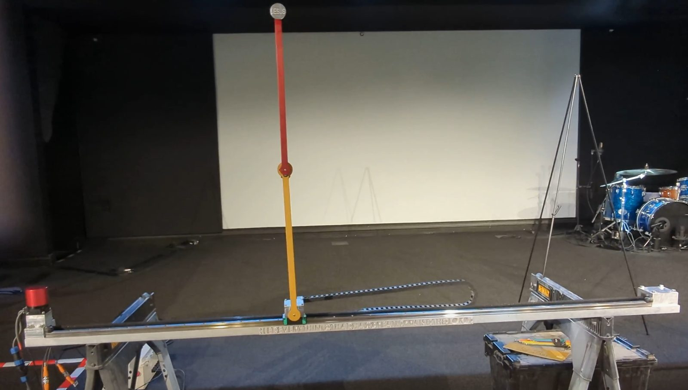
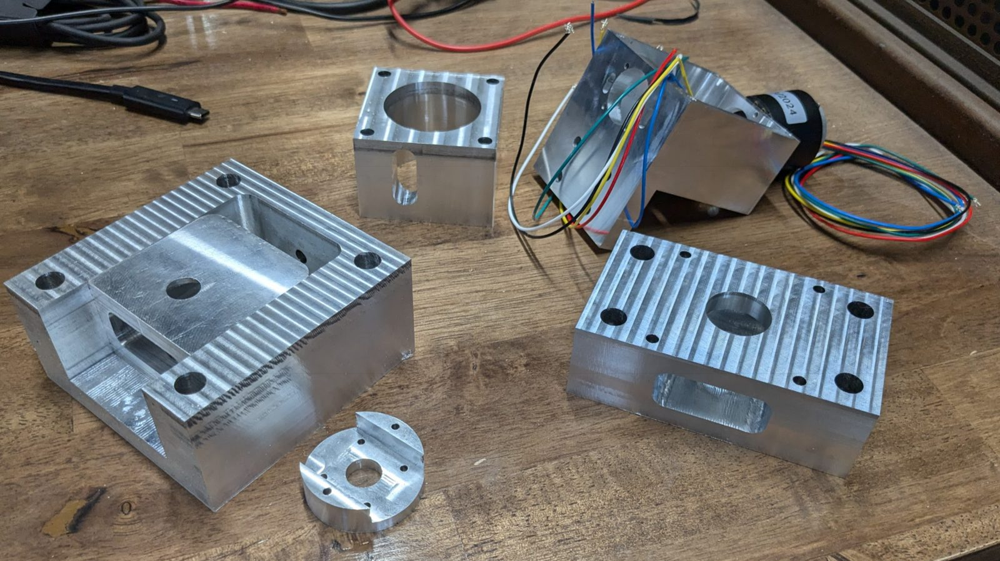

# Robotics Worship Project: Double Inverted Pendulum on a Cart

A cart-based double inverted pendulum that I designed, machined, wired, and programmed. The cart is driven by a BLDC motor under field-oriented control (FOC), and a 1 kHz full-state-feedback controller on an STM32 keeps both arms balanced upright.

▶ **[Video: double pendulum balancing](https://www.youtube.com/watch?v=LIbvaRDQooo)**

▶ **[Video: single pendulum (earlier build)](https://youtu.be/EyMTxQ-Wd4I)**

📷 **[Build album: photos and videos from design through first balance](https://photos.app.goo.gl/dTnpuS19D6qvqufP6)**



I built this partly as a challenge to grow as an engineer outside my mechanical background (embedded C, motor control, and control theory), and partly as a worship project: the top arm carries Jesus' name, so balancing it literally lifts His name up.

---

## Hardware

| Part | Details |
|---|---|
| Controller | STM32 **NUCLEO-F446RE** (Cortex-M4, 180 MHz) |
| Motor driver | ST **X-NUCLEO-IHM08M1** 3-phase power board, 48 V bus |
| Motor | BLDC, 4 pole pairs, encoder feedback, driven with FOC (torque mode) |
| Sensors | 3 quadrature encoders, 2048 PPR (×4 decoding): cart position, arm 1 angle, arm 2 angle |
| Mechanical | Linear track and belt-driven cart, free-swinging pivots; custom machined aluminum parts |
| Operator I/O | Two toggle switches (mode select), limit switches at the track ends, red/yellow/green/white status lights |



## How it works

**State estimation.** The firmware tracks a 6-element state:
cart position *x*, arm angles *θ₁* and *θ₂* (0 = upright), and their velocities.

- At **1 kHz** (TIM14), the three encoders are read and converted to meters and radians, and cart velocity is computed.
- At **50 Hz** (TIM11), the arm angular velocities are estimated by finite difference with a first-order low-pass filter.

**Balancing control.** When both arms are within ±0.5 rad of upright (the catch window), the controller applies full-state feedback, **u = K·x**, with a 6-element gain vector K. On top of that:

- a friction offset is added in the direction of cart travel
- the command is clamped to a torque limit
- the force command is converted to a q-axis current and sent to ST's Motor Control SDK in torque mode.

**Swing-up.** A precomputed cart velocity-vs-time profile is played back open-loop in speed mode to swing the arms up. An alternate force-profile version is also in the code. Once the arms are inside the catch window, switching to balance mode hands control to the feedback controller.

**Operating modes.** A small state machine, driven by the toggle switches, runs the system:

| State | What it does |
|---|---|
| Init / zero | Wait for encoders to settle, set zero offsets |
| Hub (idle) | Motor off, waiting for a mode selection |
| Swing-up | Play back the swing-up profile |
| Balance | Full-state feedback control (only entered when inside the catch window) |
| Reset / re-zero | Clear fault flags, or re-zero the encoders |

**Safety.** Control drops back to the idle hub state if any of these happen:
- a track-end limit switch opens
- the cart leaves its soft position limits
- the cart exceeds a speed limit
- the motor overheats
- the arms fall out of the catch window

The status lights show which state the system is in.

## Repo layout

```
firmware/
  Core/Src/main.c           control loop, state machine, swing-up, safety logic (my code is
                            inside the USER CODE blocks; the rest is STM32CubeMX boilerplate)
  Core/Src/quad_encoder.c   quadrature encoder reading (timer counter → position/velocity)
  Core/Inc/quad_encoder.h
  Praise the Lord.ioc       STM32CubeMX pin/peripheral configuration
  Praise the Lord.stwb6     ST Motor Control Workbench motor + FOC configuration
simulation/                 Python model and controller simulation (coming soon)
media/                      photos
```

**Not included:** ST's HAL drivers and Motor Control SDK (MCSDK v6.3.2). They are vendor code and can be regenerated by opening the `.stwb6` file in ST Motor Control Workbench and the `.ioc` file in STM32CubeMX.

## Status and lessons learned

- This is the code as it ran for the demo in the video (February 2025), kept as-is rather than cleaned up afterward.
- An angular drift-compensation routine (rolling average of arm angles) is written but disabled. Getting the encoder zeroing right made it unnecessary for the demo.
- If I rebuilt it, I would estimate the arm velocities at the full 1 kHz rate with an observer or Kalman filter instead of a 50 Hz filtered difference, and make the swing-up-to-balance handoff automatic.
